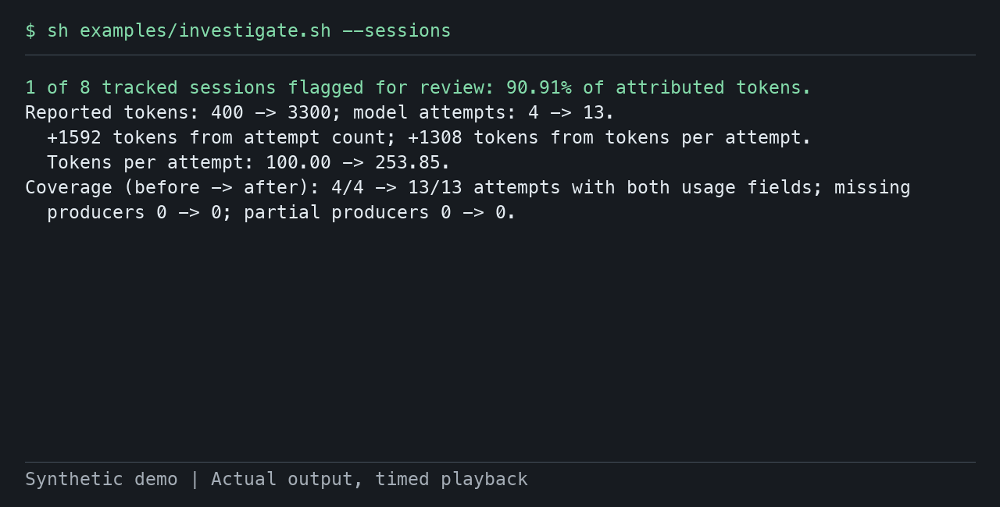

# fleetdiff

[](https://scorecard.dev/viewer/?uri=github.com/llm-measurement/fleetdiff)

fleetdiff is a local command-line tool that investigates LiteLLM spend exports,
compares LLM usage summaries, flags unusual windows, and checks trace captures
and collector configurations.

Use it to answer **why LLM token usage spiked, and which users or sessions drove
the change.** It reads your files and prints a report: no account, upload,
collector or model API key is needed for the LiteLLM path.

| | |
| --- | --- |
| Commands | `investigate`, `scan`, `compare`, `inspect`, `diagnose` |
| Platforms | Linux and macOS, AMD64 and ARM64 |
| Status | Pre-1.0; see the [changelog](CHANGELOG.md) |
| License | Apache-2.0 |

## Using LiteLLM?

**Export -> install -> investigate.** Use the request logs you already retain to
compare two periods, see which models and keys drove the change, and check
whether the usage records are complete.

### 1. Export Request-Level Rows

Use the [read-only SQL projection](examples/litellm-spend/export.sql) and your
existing PostgreSQL access. The [export guide](examples/litellm-spend/README.md#export-request-level-rows)
covers connection settings and version-pinned cache fields. Once your approved
read-only connection is named `litellm_readonly`, this example exports 16 UTC days:

```sh
umask 077
export_dir="$HOME/litellm-export"
mkdir "$export_dir"
curl --fail --location --proto '=https' --tlsv1.2 \
  https://raw.githubusercontent.com/llm-measurement/fleetdiff/v0.6.0/examples/litellm-spend/export.sql \
  --output "$export_dir/export.sql"
psql 'service=litellm_readonly' -Xq -v ON_ERROR_STOP=1 \
  -v start_utc=2026-09-23T00:00:00Z -v end_utc=2026-10-09T00:00:00Z \
  -v csv_file="$export_dir/spend.csv" -f "$export_dir/export.sql" \
  >"$export_dir/private-psql.out" 2>"$export_dir/private-psql.err"
```

Choose dates for your own data and continue only after the export succeeds.
The SQL writes CSV in one pass and excludes prompts and responses. Keep the
export directory private. Existing request-level JSON and JSONL work too.

<a id="2-install-v060"></a>

### 2. Install v0.6.1

Run this in Bash with `curl`, `gh`, `shasum` and `tar` available:

```sh
bash -o pipefail -c 'curl --fail --location --proto "=https" --tlsv1.2 https://raw.githubusercontent.com/llm-measurement/fleetdiff/7773f212e4ae6e800f066b394e5507c0df8ada5f/scripts/install.sh | sh -s -- v0.6.1 ./fleetdiff-install'
./fleetdiff-install/fleetdiff --version
```

The installer checks signed release provenance and checksums before extracting
the binary into a new directory. Prefer to inspect the script first? Follow
[Install and verify](docs/OPERATIONS.md#install-and-verify).

### 3. Investigate

```sh
./fleetdiff-install/fleetdiff investigate \
  --litellm-spend "$export_dir/spend.csv" --group-by key
```

With enough history, fleetdiff compares the two most recent complete seven-day
UTC periods inside the file and prints their exact boundaries and weekdays.
For shorter exports or chosen periods, set `--before-period` and `--after-period`
to dates or explicit UTC start/end intervals.

The report shows request count versus tokens per request by model, the leading
contributors, and usage completeness. Choose `--group-by team`, `user`, `end-user`
or `session` for another view; add `--format json` for automation.
[Export guide](examples/litellm-spend/README.md); [unreleased cache comparison](docs/CACHE.md).

## Try One Example

Download the synthetic spend file and use the installed binary:

```sh
curl --fail --location --proto '=https' --tlsv1.2 \
  https://raw.githubusercontent.com/llm-measurement/fleetdiff/v0.6.0/examples/litellm-spend/synthetic.csv \
  --output synthetic.csv
./fleetdiff-install/fleetdiff investigate --litellm-spend synthetic.csv \
  --before-period 2026-10-07 --after-period 2026-10-08
```

Selected output:

```text
Recorded tokens doubled (8,000 -> 16,000).
model-1 accounts for 100% of the net recorded increase (+8,000 tokens).
  model-1: 4,000 -> 12,000 recorded tokens; 4 -> 6 requests.
    1,000.00 -> 2,000.00 recorded tokens per request; +3,000 from request count, +5,000 from request size.
  2 leading tracked keys account for 100% of the net recorded increase.
  Zero-only records, origin unknown: 2 -> 4.
  Failed records (overlap usage categories): 1 -> 2.
```

Two keys explain the increase. The zero-only and failed rows point to records
worth reviewing in LiteLLM. The [fixture and checks](examples/litellm-spend/TESTING.md)
make these answers reproducible.

The summary-file path also shows session concentration:



[Run the sessions demo](examples/sessions/README.md) |
[Read its transcript](docs/media/sessions-transcript.txt).

<a id="install-a-binary"></a>

## Install

The verified installer above selects the native binary for your machine.
For manual downloads, use the [v0.6.1 archives](https://github.com/llm-measurement/fleetdiff/releases/tag/v0.6.1)
and [verification instructions](docs/OPERATIONS.md#install-and-verify).
An administrator can verify and transfer artifacts through an approved internal mirror.

With a security-patched Go 1.26 toolchain, install the same version from its module:

```sh
go install github.com/llm-measurement/fleetdiff/cmd/fleetdiff@v0.6.1
```

The executable goes to `GOBIN`, or `$(go env GOPATH)/bin` when unset.
See [source builds and version reporting](docs/OPERATIONS.md#build-from-source).

## Limits

- Spend reports describe the supplied logged model requests. Missing usage,
  ambiguous zero-only counts and failures remain visible; unsupported call types
  lead with an incomplete comparison. Provider records remain the source for billing.
- Use request-level exports. The LiteLLM Usage dashboard's daily aggregates
  receive instructions for getting those rows. The reader accepts up to 10M rows
  and 16 GiB per file, with [per-record limits](examples/litellm-spend/README.md#data-and-limits).
- Reports use local aliases or keyed hashes. Hashes are pseudonymous and linkable;
  keep source files private and share reports under your organization's policy.
- Rankings carry deterministic bounds; distinct counts are statistical estimates.
  A flagged contributor identifies something to investigate, rather than its cause.
  Compatible summary files need aligned windows, keys and disjoint producer coverage.

## Documentation

- [LiteLLM spend exports](examples/litellm-spend/README.md): SQL, periods, groupings and source accounting.
- <a id="try-it-in-a-minute"></a><a id="did-one-session-account-for-most-of-the-increase"></a> [Single-application and session examples](docs/WORKFLOWS.md#try-it-in-a-minute).
- <a id="will-it-work-with-my-traces"></a> [Inspect your traces](docs/INSPECT.md) and [capture recipes](examples/inspect/README.md).
- <a id="set-up-and-keep-watching"></a> [Diagnose configurations](docs/DIAGNOSE.md), [scan history](docs/SCAN.md) and [compare cache use](docs/CACHE.md).
- <a id="keep-watching-litellm"></a> [Continuous LiteLLM collection](docs/WORKFLOWS.md#keep-watching-litellm).
- <a id="extend-to-separately-operated-agents"></a><a id="run-it-through-real-collectors"></a> [Several operators and live collectors](docs/WORKFLOWS.md#extend-to-separately-operated-agents).
- <a id="questions-it-answers"></a><a id="user-and-session-contributors"></a> [Questions and contributor rankings](docs/WORKFLOWS.md#questions-it-answers).
- <a id="how-it-works"></a><a id="use-your-own-data"></a><a id="reading-the-results"></a> [How summary comparison works](docs/WORKFLOWS.md#how-it-works), [comparison contract](docs/COMPARISON.md) and [investigation contract](docs/INVESTIGATION.md).
- <a id="built-to-be-checked"></a> [Operations](docs/OPERATIONS.md), [resource measurements](docs/BENCHMARKS.md) and [checks](docs/WORKFLOWS.md#built-to-be-checked).
- <a id="docs"></a> [FAQ](docs/FAQ.md), [security](SECURITY.md), [release notes](docs/releases/v0.6.1.md) and [release procedure](docs/RELEASING.md).

Questions or feedback: [open an issue](https://github.com/llm-measurement/fleetdiff/issues).
See [Contributing](CONTRIBUTING.md) for checks and signed, signed-off commits.
Code authors: Vijay and Codex.
